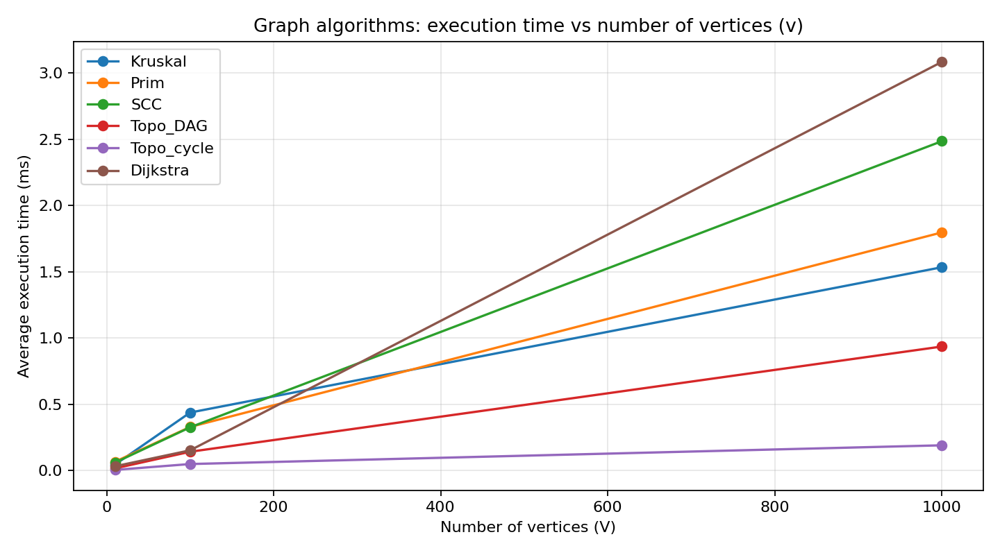
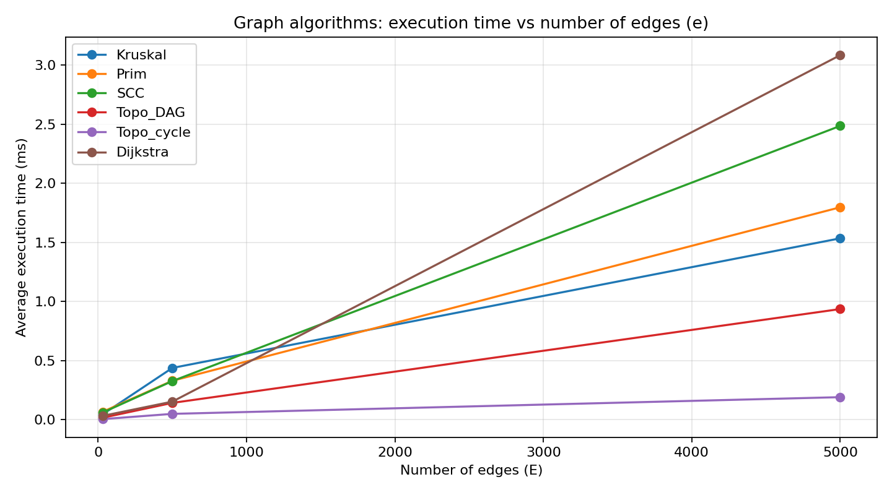

# Assignment 3 — Smart City Infrastructure and Route Planning

## Overview
This Java project represents city districts as graph vertices and roads as weighted edges.
An undirected graph models two-way roads and minimum-cost infrastructure. A directed graph
models one-way roads, dependencies and shortest routes. All vertices are numbered from 0 to V-1.

## Implementation
- `graph/Graph.java`, `Edge.java`: adjacency lists plus an edge list, directed/undirected support.
- `dsu/DSU.java`: union-find with path compression and union by rank.
- `mst/Kruskal.java`: sort all roads by cost, use DSU to avoid cycles; returns total, selected roads,
  connected flag and operation count.
- `mst/Prim.java`: build a tree from district 0, using a priority queue; returns the same fields.
- `connectivity/TopologicalSort.java`: Kahn's queue-based algorithm, detects a cycle when
  fewer than V vertices are produced.
- `connectivity/SCC.java`: iterative Kosaraju algorithm, two depth-first passes and transpose graph.
- `shortestpath/Dijkstra.java`: priority-queue shortest paths, predecessor array and reconstruction;
  unreachable vertices have distance `INF`. Negative weights are rejected with an exception.
- `experiments/GraphGenerator.java`: reproducible simple graphs; no self-loops or parallel edges.
- `experiments/Benchmark.java`: algorithm benchmarking and CSV export.
- `tests/GraphTest.java`: small correctness tests using plain Java assertions (no external test framework).

All code needs only the Java JDK (17+ recommended); plots are generated with Python matplotlib.

## How to run
Open the folder as a Java project in IntelliJ IDEA, configure a JDK, then right-click
`src/Main.java`, `src/tests/GraphTest.java` or `src/experiments/Benchmark.java` and Run.
Run Benchmark with **the project root as its working directory**, so `results/tables/benchmark.csv`
is created in the correct place.

Command line (Linux/macOS, from the project root):

```bash
mkdir -p out
javac -d out $(find src -name '*.java')
java -cp out Main
java -cp out tests.GraphTest
java -cp out experiments.Benchmark
python results/plots/make_plots.py
```

Windows PowerShell (from the project root):

```powershell
New-Item -ItemType Directory -Force out | Out-Null
$files = Get-ChildItem src -Recurse -Filter *.java | ForEach-Object { $_.FullName }
javac -d out $files
java -cp out Main
java -cp out tests.GraphTest
java -cp out experiments.Benchmark
py results/plots/make_plots.py
```

For the last command, install matplotlib once with `py -m pip install matplotlib`,
if you want to regenerate plots. The two PNG plots are already included.

## Complexity analysis
Let V = vertices, E = edges, and α(V) = the inverse Ackermann function. Assume adjacency
lists, non-negative weights for Dijkstra, and a binary-heap priority queue.

| Algorithm | Time complexity | Extra space | Explanation |
|---|---|---|---|
| DSU find/union | O(α(V)) amortized per operation | O(V) | Path compression and rank keep trees shallow. |
| Kruskal | O(E log E + E α(V)) | O(V + E) | Sort edges, then check DSU for each edge. |
| Prim | O((V + E) log (V + E)) | O(V + E) | Push and remove candidate edges in a binary heap. |
| Kosaraju SCC | O(V + E) | O(V + E) | Two DFS traversals and reversed edges. |
| Topological sort | O(V + E) | O(V + E) | Each vertex and edge processed at most a constant number of times. |
| Dijkstra | O((V + E) log (V + E)) | O(V + E) | Heap-based relaxations; duplicate heap entries may occur. |

Dijkstra's greedy selection is not valid with negative weights: a vertex considered
final can later receive a shorter path. This implementation rejects negative edge weights.

## Experimental setup
Three graph sizes: **(V=10, E=30), (V=100, E=500), (V=1000, E=5000)**.
Each test uses `Random(42)`. Connected undirected test graphs first add an edge
from each vertex i > 0 to a random previous vertex (a spanning tree), then random distinct
undirected edges until exactly E roads exist. All weights are random integers from 1 to 100.
Directed graphs draw unique ordered edges. In DAG graphs, edges always point from a smaller
vertex index to a larger one, so cycles cannot occur. For cyclic graphs, edges
0→1, 1→2, 2→0 are added before drawing the remaining edges.

For each algorithm and size, a warm-up run executes first; then 5 timed runs are measured
with `System.nanoTime()`. The CSV contains their average duration in milliseconds and their
average *instrumented* operation count. Timings include algorithm data structure setup,
not graph generation, test validation or CSV writing. All five repetitions use the same
generated graph, so measurements are reproducible in graph structure but runtime depends
on the computer/JVM load. A single warm-up does not eliminate all JVM/JIT effects.

Operation counts are specific to each implementation: Kruskal counts sorting comparisons,
examined edges, DSU find calls and union calls; Prim counts priority queue comparator calls
and examined edges; SCC counts vertices/edges visited in its passes and transpose generation;
Topological sort counts indegree updates, popped vertices and processed outgoing edges;
Dijkstra counts queue pops and edge relaxations. **Counts from different algorithms are not
identical units**, so interpret cross-algorithm counts cautiously.

## Results
The following values were measured in this environment. Re-run Benchmark on your machine
and update the table if you need numbers measured on your own computer.

| Algorithm | V | E | Avg time (ms) | Avg counted operations |
|---|---:|---:|---:|---:|
| Kruskal | 10 | 30 | 0.0446 | 179 |
| Prim | 10 | 30 | 0.0661 | 294 |
| SCC | 10 | 30 | 0.0596 | 101 |
| Topo_DAG | 10 | 30 | 0.0161 | 70 |
| Topo_cycle | 10 | 30 | 0.0045 | 30 |
| Dijkstra | 10 | 30 | 0.0319 | 42 |
| Kruskal | 100 | 500 | 0.4376 | 4736 |
| Prim | 100 | 500 | 0.3289 | 9198 |
| SCC | 100 | 500 | 0.3262 | 1601 |
| Topo_DAG | 100 | 500 | 0.1417 | 1100 |
| Topo_cycle | 100 | 500 | 0.0489 | 500 |
| Dijkstra | 100 | 500 | 0.1525 | 645 |
| Kruskal | 1000 | 5000 | 1.5344 | 69963 |
| Prim | 1000 | 5000 | 1.7973 | 125959 |
| SCC | 1000 | 5000 | 2.4859 | 16011 |
| Topo_DAG | 1000 | 5000 | 0.9360 | 11000 |
| Topo_cycle | 1000 | 5000 | 0.1903 | 5064 |
| Dijkstra | 1000 | 5000 | 3.0845 | 6365 |






## Comparison and discussion
- Kruskal and Prim generated identical MST **total weights** on all three connected
  undirected graphs (the selected edge sets may differ when equal weights appear).
- SCC and topological ordering have linear O(V+E) asymptotic costs; measured time usually
  grows as the graph grows, but short measurements are affected by JVM overhead.
- Topological ordering returns a valid ordering for the generated DAG and correctly reports
  cycles for the graph with forced directed 3-cycle.
- Dijkstra's number of edge relaxations grows with the reachable graph size and its heap
  adds logarithmic work.
- The two required graphs compare V and E respectively; here V and E grow together in
  the three configurations. **These experiments do not isolate the effect of changing V
  independently of E**. A controlled follow-up experiment could fix one and vary the other.
- Measured timings are examples, not universal speed rankings. Different machines or
  random graph patterns may change which MST approach is faster.

## Testing
Run `tests.GraphTest`: 14 checks covering DSU, connected and disconnected MSTs,
cycles, multiple valid MSTs, duplicate weights, one vertex, a valid DAG ordering,
cycle rejection, SCC partition, reachable/unreachable Dijkstra paths, correct distances
and negative-edge rejection. This test suite passed locally. In addition, Benchmark
checks MST total-weight equality and expected DAG/cycle detection for every size.

## Conclusion
Use Kruskal or Prim for a minimum-cost connected two-way road network. Kruskal is
convenient with an edge list; Prim grows a network from one district. Use SCC to find
mutually reachable groups in a one-way network; topological sorting for dependency
planning without cycles; and Dijkstra to find shortest non-negative-cost routes.

## Repository and commits
Upload the complete project (source, README, CSV and PNGs) to GitHub. Suggested meaningful
commits while developing: `Add graph and DSU classes`, `Implement MST algorithms`,
`Add directed graph algorithms`, `Add tests and benchmark`, `Document results and plots`.
Do not claim past commits that you did not actually make. Do not commit the generated `out/` folder.
